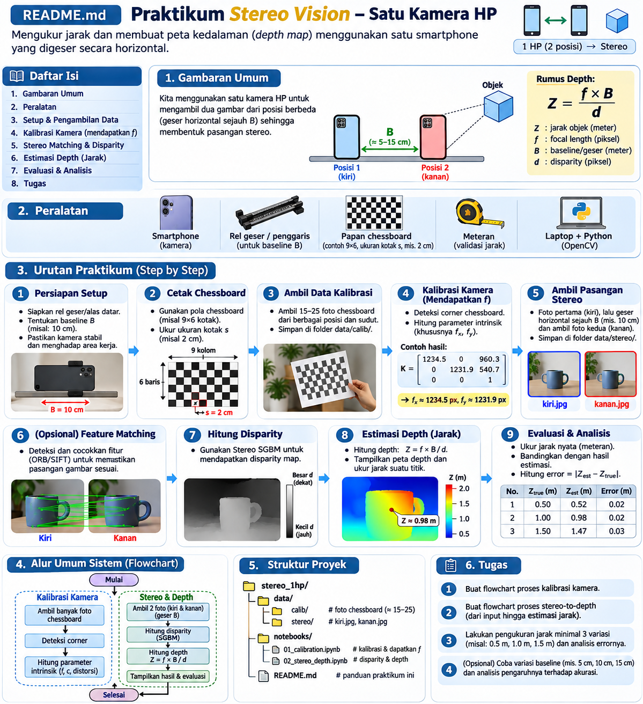
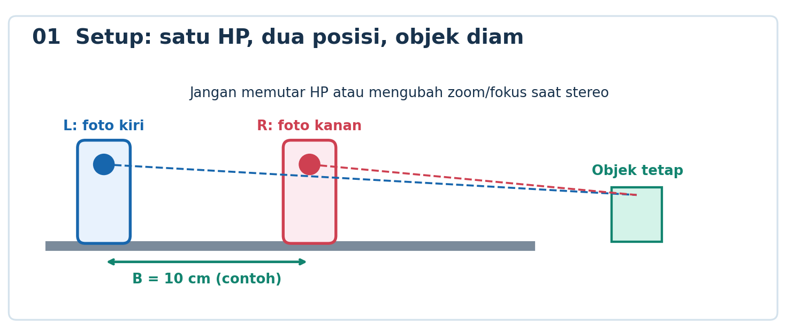
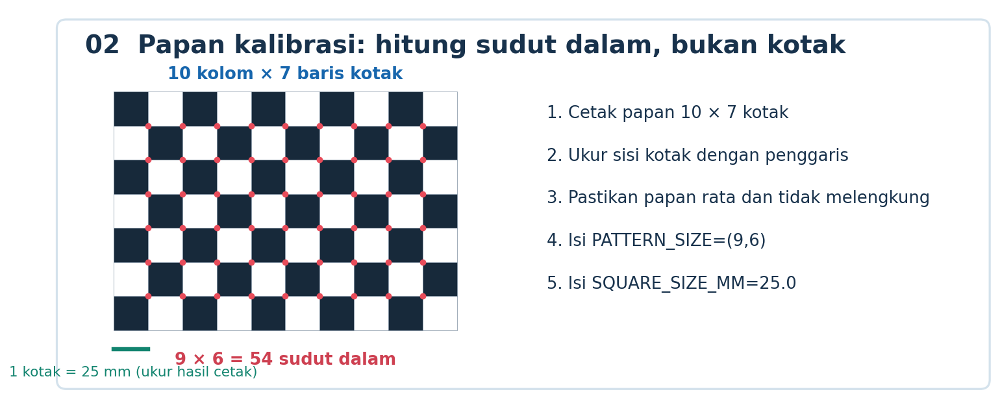
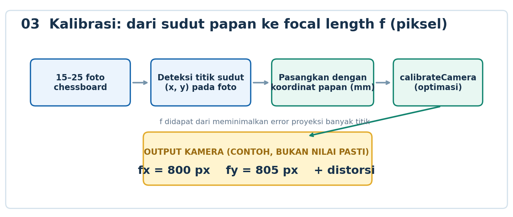
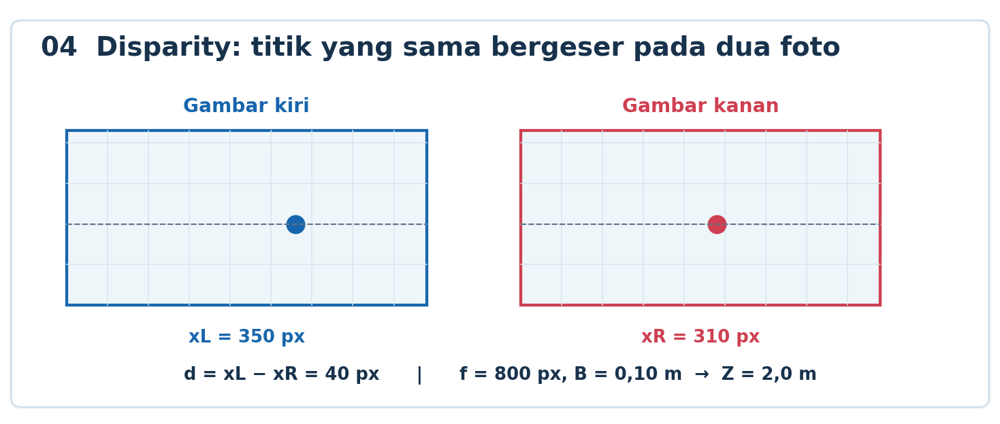
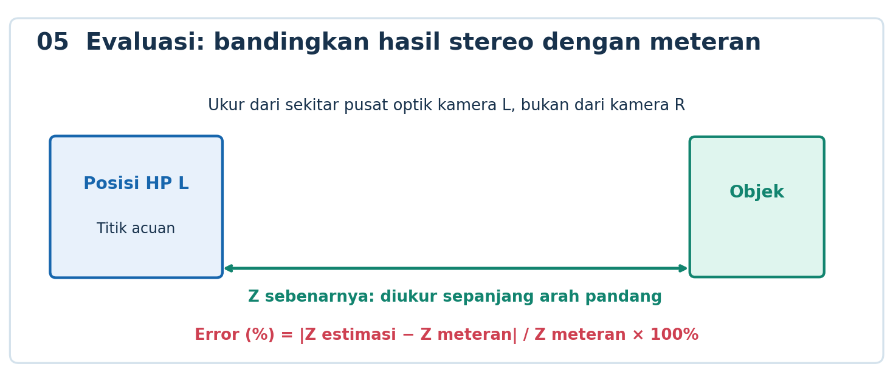
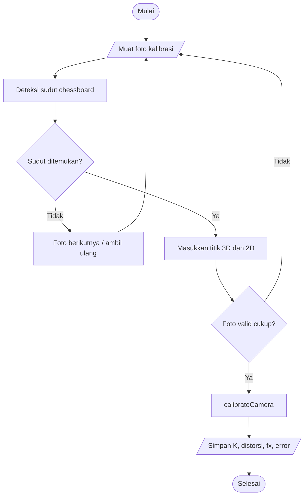

# Praktikum Computer Vision — Stereo Vision dengan Satu HP Digeser

> **Tujuan:** mendapatkan **panjang fokus kamera dari kalibrasi**, membuat sepasang foto stereo dengan **satu smartphone**, menghitung **disparity**, memperkirakan **depth**, lalu mengukur error. Dikerjakan memakai **Google Colab atau Jupyter Notebook**.
>
> **Berkas notebook:** [`Praktikum_Stereo_1_HP_Kalibrasi_Depth_Flowchart.ipynb`](Praktikum_Stereo_1_HP_Kalibrasi_Depth_Flowchart.ipynb). 



## A. Target pembelajaran

Setelah praktikum, mahasiswa dapat (1) menjelaskan perbedaan data kalibrasi dan data stereo; (2) memperoleh `fx` dan `fy` **dalam piksel**, bukan mengasumsikan 800 px; (3) menghitung `d = xL - xR`; (4) menghitung `Z = fx × B / d` dengan satuan konsisten; (5) menunjukkan kesalahan pengukuran; dan (6) membuat **dua flowchart** sesuai kode notebook.

## B. Alat dan persiapan

| Kebutuhan | Fungsi | Catatan |
|---|---|---|
| 1 smartphone | Satu kamera untuk semua foto | Pakai **lensa utama yang sama**, hindari pergantian lensa otomatis |
| Rel/dudukan geser lurus | Menahan HP agar orientasi tidak berubah | Alternatif: alas lurus, penanda posisi L dan R, penyangga stabil |
| Penggaris dan meteran | Mengukur ukuran kotak, baseline, dan jarak objek | **Baseline** bukan jarak tepi HP, melainkan perpindahan pusat kamera |
| Papan chessboard 10 × 7 kotak | Kalibrasi kamera | Menghasilkan **9 × 6 sudut dalam**; cetak datar pada kertas/karton |
| Objek diam dengan tekstur | Pengujian stereo | Kotak bermotif, buku, mainan; hindari kaca dan permukaan polos |
| Laptop + Python/OpenCV | Memproses foto | Google Colab boleh; tidak perlu dua webcam |

**Aturan:** ambil foto dengan resolusi, orientasi, zoom, kamera, dan pengaturan fokus yang sama; sebaiknya kunci fokus dan eksposur jika aplikasi kamera mendukungnya. Matikan mode potret, HDR yang mengubah geometri, dan koreksi perspektif otomatis bila memungkinkan. Jangan mengubah konfigurasi kamera sesudah kalibrasi.



## C. Urutan praktikum — ikuti dari awal sampai akhir

### Langkah 1 — Tentukan baseline dan siapkan rel

1. Pasang HP pada rel horizontal/alas lurus dengan posisi yang dapat ditandai.
2. Beri tanda **L** (awal) dan **R** (10 cm ke kanan sebagai contoh).
3. Ukur perpindahan pusat kamera belakang dari L ke R: `BASELINE_CM = 10.0` (ubah sesuai pengukuran nyata).
4. Arah kamera harus tetap sama; **jangan diputar ke arah objek** setelah digeser.
5. Pilih objek **diam** dan pastikan terlihat dari kedua posisi.

**Checkpoint:** catat `B = ... cm` dan foto setup rel beserta penggaris. Jika baseline tidak diketahui, depth metrik tidak dapat dihitung dengan benar.

### Langkah 2 — Cetak chessboard dan ukur ukuran kotaknya

1. Siapkan gambar chessboard **10 kotak mendatar × 7 kotak tegak**.
2. Cetak tanpa fitur *fit to page* yang mengubah ukuran secara tidak sengaja, lalu tempel pada bidang rata.
3. Ukur satu sisi kotak dari hasil cetak dengan penggaris; contoh **25 mm**.
4. Ingat: OpenCV membaca **9 × 6 sudut bagian dalam**, bukan 10 × 7 kotak.



**Checkpoint:** foto papan + penggaris; tulis `PATTERN_SIZE = (9,6)` dan `SQUARE_SIZE_MM = 25.0` (atau nilai hasil ukur Anda).

### Langkah 3 — Kumpulkan 15–25 foto kalibrasi

1. Gunakan kamera HP yang akan digunakan untuk foto stereo.
2. Foto papan chessboard **15–25 kali** dengan sudut dan lokasi papan bervariasi: tengah, dekat tepi, miring kanan/kiri, lebih dekat/jauh.
3. Untuk kalibrasi, **boleh mengubah arah HP** antar-foto. Perubahan sudut ini justru berguna untuk mengestimasi parameter kamera.
4. Pastikan setiap foto memperlihatkan seluruh pola, tidak blur, pantulan berlebihan, atau terpotong.
5. Simpan sebagai `cal_01.jpg`, `cal_02.jpg`, ... di folder `calibration/`.

**Perbedaan penting:** pada tahap ini kamera **belum** digeser untuk membentuk stereo. Kita mengumpulkan foto untuk memperoleh parameter kamera.

### Langkah 4 — Jalankan kalibrasi dan temukan nilai `f`

1. Buka notebook. Jalankan **sel `3A`** untuk konfigurasi. Atur `PATTERN_SIZE`, `SQUARE_SIZE_MM`, `BASELINE_CM`.
2. Jika menggunakan Colab, buat ZIP folder data (struktur contoh di bawah) dan jalankan **sel `3B`** untuk mengunggahnya.
3. Jalankan **sel `4A`**: OpenCV mendeteksi titik sudut chessboard pada masing-masing foto.
4. Periksa foto yang gagal dideteksi; ganti dengan foto yang tajam bila jumlahnya kurang.
5. Jalankan **sel `4B`**: OpenCV `cv2.calibrateCamera()` memperkirakan matriks kamera dan distorsi.
6. Catat `fx`, `fy`, `cx`, `cy`, `RMS reprojection error`, dan koefisien distorsi. Simpan `calibration.npz`.



**Bagaimana angka seperti `fx = 800 px` diperoleh?** OpenCV mengetahui jarak antarsudut **di papan**, mendeteksi posisi sudut dalam **piksel**, lalu mencari parameter proyeksi kamera yang meminimalkan kesalahan antara titik sudut yang teramati dan yang diproyeksikan secara matematis. **800 px hanyalah contoh**, bukan angka yang harus diperoleh mahasiswa.

Matriks intrinsik yang diestimasi:

```text
K = [ fx   0  cx ]
    [  0  fy  cy ]
    [  0   0   1 ]
```

`fx` dan `fy` = panjang fokus efektif dalam piksel, sedangkan `cx` dan `cy` = lokasi pusat proyeksi dalam piksel (bukan focal length). Nilai `fx` yang dipakai pada rumus depth horizontal.

**Checkpoint:** tangkapan layar deteksi corner + cetakan nilai K + error. Jika error besar, perbaiki foto/papan terlebih dahulu.

### Langkah 5 — Ambil sepasang foto stereo dari satu HP

1. Pertahankan kamera, zoom, resolusi, fokus, dan eksposur seperti kalibrasi.
2. Tempatkan HP pada penanda **L**, arahkan ke objek diam → simpan **`left.jpg`**.
3. **Geser HP ke kanan** sejauh baseline yang diukur (contoh 10 cm) **tanpa rotasi atau naik/turun** → simpan **`right.jpg`**.
4. Jangan menggeser objek maupun background. Pastikan area yang sama tetap terlihat.
5. Simpan kedua foto di folder `stereo/`.

**Checkpoint:** periksa apakah gambar kiri/kanan memiliki resolusi sama dan tidak ada perubahan orientasi, zoom, atau gerakan objek.

### Langkah 6 — Siapkan struktur data lalu jalankan notebook

Buat folder berikut, kemudian kompres `praktikum_stereo` menjadi ZIP untuk Google Colab jika dibutuhkan.

```text
praktikum_stereo/
├── calibration/
│   ├── cal_01.jpg
│   ├── cal_02.jpg
│   └── ... (15–25 foto)
├── stereo/
│   ├── left.jpg
│   └── right.jpg
└── output/                 # otomatis dibuat oleh notebook
```

Urutan sel penting notebook:

| Sel | Kegiatan | Yang dicek |
|---|---|---|
| `3A` dan opsional `3B` | Konfigurasi + unggah data | Path data, ukuran kotak, baseline |
| `4A` → `4B` | Deteksi chessboard → kalibrasi | `fx`, `fy`, RMS error |
| `5A` → `5B` | Koreksi distorsi → uji keselarasan | Titik yang sama hampir satu baris |
| `6A` | Contoh manual hitung disparity/depth | Ganti nilai contoh dengan data yang diukur |
| `7A` | StereoSGBM dan depth map | Disparity valid, tidak didominasi noise |
| `8A` | ROI pengukuran | Lokasi ROI pada objek; median depth |
| `9A` | Kalkulator teori | Bandingkan perubahan baseline/depth |

### Langkah 7 — Pemeriksaan keselarasan (alignment)

1. Jalankan **sel `5A`** untuk koreksi distorsi (`cv2.undistort`).
2. Jalankan **sel `5B`** untuk mencocokkan fitur ORB dan memeriksa selisih koordinat vertikal `|yL-yR|`.
3. Bila `median |yL-yR|` cukup besar, kembali ke Langkah 5: rel tidak sejajar / HP berotasi. Nilai kecil (mis. sekitar 1–2 px) adalah indikator awal, **bukan jaminan** stereo benar-benar rectified.
4. **Kalibrasi satu kamera tidak otomatis menghasilkan stereo rectification** untuk dua posisi nyata. Notebook ini mengasumsikan perpindahan horizontal murni; untuk akurasi lebih tinggi perlu stereo calibration/pose estimation dan rectification pasangan tersebut.

**Checkpoint:** tangkapan layar ORB matching dan nilai median selisih vertikal. Jika foto bermasalah, jangan melanjutkan interpretasi depth seolah-olah pasti benar.

### Langkah 8 — Mengerti disparity secara manual

Cari satu titik fisik yang sama pada gambar kiri dan kanan. Ambil koordinat horizontalnya:

```text
xL = 350 px
xR = 310 px
d  = xL - xR = 40 px
```



Untuk gambar stereo paralel ter-rektifikasi, gunakan:

\[
Z = \frac{f_x B}{d}
\]

**Contoh ilustratif**, bukan hasil ukur kamera tertentu: `fx = 800 px`, `B = 0.10 m`, `d = 40 px` → `Z = 2.0 m`. Pada notebook, jalankan **sel `6A`**, lalu gunakan `fx` hasil **kalibrasi aktual**, bukan 800 yang hanya demo.

### Langkah 9 — Membuat disparity map otomatis dan depth map

1. Jalankan **sel `7A`**: OpenCV `StereoSGBM` mencari pergeseran horizontal dari banyak blok/piksel.
2. Keluaran OpenCV `compute()` dibagi **16** untuk mendapatkan disparity dalam piksel.
3. Piksel dengan disparity tidak valid **tidak boleh dipaksakan menjadi depth**.
4. Buat peta kedalaman dari `Z = fx × B / d` untuk piksel valid dan amati hasilnya.
5. Simpan gambar kiri terkoreksi, `disparity_px.npy`, `depth_m.npy` ke `output/`.

**Checklist:** objek yang lebih dekat seharusnya cenderung punya disparity lebih besar daripada objek jauh (dengan geometri yang benar). Area polos/reflektif dapat menghasilkan hasil kosong atau noise.

### Langkah 10 — Ukur depth di satu objek dengan ROI

1. Pada gambar kiri, pilih area di **bagian dalam objek** yang cukup bertekstur.
2. Set `ROI_X`, `ROI_Y`, dan `ROI_HALF` di **sel `8A`**.
3. Gunakan median depth piksel valid pada ROI (lebih stabil daripada satu piksel).
4. Ukur jarak objek nyata dengan meteran, sebaiknya sepanjang arah pandang dari sekitar **pusat kamera di posisi L**.
5. Isi `DEPTH_REFERENSI_M` dan hitung error.



**Catatan:** `Z` adalah koordinat kedalaman sepanjang sumbu optik, **tidak selalu sama dengan jarak lurus miring** dari kamera ke objek yang berada jauh dari pusat gambar.

### Langkah 11 — Eksperimen minimal tiga jarak

Gunakan baseline tetap, misalnya 10 cm. Ambil **pasangan foto baru untuk setiap jarak objek**; jalankan ulang tahap stereo (`5A`–`8A`) tanpa harus kalibrasi ulang jika konfigurasi kamera tidak berubah.

| No. | Baseline B (cm) | Jarak meteran Z (m) | Median disparity (px) | Depth estimasi (m) | Error (%) |
|---|---:|---:|---:|---:|---:|
| 1 | 10 | 0.50 | isi | isi | isi |
| 2 | 10 | 1.00 | isi | isi | isi |
| 3 | 10 | 1.50 | isi | isi | isi |

\[
\mathrm{Error}(\%)= \frac{|Z_\mathrm{estimasi}-Z_\mathrm{meteran}|}{Z_\mathrm{meteran}}\times 100\%
\]

**Analisis wajib:** mengapa disparity turun ketika objek menjauh? Apa efek salah ukur baseline? Apa yang terjadi jika HP sedikit berotasi? Bandingkan permukaan bertekstur dan polos.

## D. Tugas: buat flowchart dari kode nyata

Buat **dua flowchart** (diagrams.net/draw.io, PowerPoint, atau Mermaid), bukan sekadar menyalin contoh visual:

**Flowchart A — Kalibrasi** memuat: mulai → input foto chessboard → loop foto → `findChessboardCorners` → keputusan sudut terdeteksi? → `cornerSubPix` → simpan pasangan titik 3D–2D → keputusan jumlah foto valid cukup? → `calibrateCamera` → keluarkan `fx`, `fy`, `cx`, `cy`, error → simpan `calibration.npz` → selesai.

**Flowchart B — Stereo-to-depth** memuat: input `left.jpg`/`right.jpg` → validasi resolusi dan parameter kalibrasi → `undistort` → ORB dan pemeriksaan selisih y → keputusan alignment cukup baik? → `StereoSGBM.compute` → ubah skala `/16` → cek `d > 0` → depth `Z=fx×B/d` → ambil median ROI → hitung error terhadap meteran → simpan hasil → selesai. Tambahkan cabang kembali mengambil foto jika alignment gagal.

Contoh kerangka untuk **flowchart A** (harus dikembangkan dari kode):



**Penyerahan:** notebook yang sudah dijalankan, foto setup + penggaris, foto papan + ukurannya, foto sudut chessboard terdeteksi, matriks K dan error, gambar stereo, matching, disparity/depth map, tabel hasil minimal 3 jarak, analisis, **2 flowchart**.

**Rubrik (100):** kalibrasi & penjelasan focal length 25; kualitas pengambilan stereo 20; disparity/depth 20; evaluasi error 15; dua flowchart 20.

## E. Troubleshooting

| Masalah | Perbaikan |
|---|---|
| Sudut chessboard tidak terdeteksi | Pastikan pola **10×7 kotak**, tidak blur, seluruh pola masuk frame |
| `fx` tidak wajar / reprojection error besar | Tambah variasi sudut, pastikan papan datar, resolusi konsisten, jangan ganti lensa |
| `median |yL-yR|` besar | Ulang pasangan stereo; HP jangan berotasi atau berubah tinggi |
| `d` negatif / nol | Periksa urutan kiri-kanan, arah geser, dan titik yang dicocokkan |
| Disparity map bising / kosong | Perbaiki alignment, tambah tekstur/cahaya, tuning parameter SGBM |
| Jarak jauh sangat meleset | Periksa baseline, kalibrasi, kualitas disparity yang kecil, serta fokus kamera |
| Colab tidak menemukan gambar | Periksa folder ZIP dan `DATA_DIR`; sesuaikan path di sel `3A` |

## F. Catatan ilmiah & referensi

- Model sederhana ini menganggap dua posisi kamera **paralel**, berfokus pada **objek diam**, dan baseline murni horizontal. Distorsi dikoreksi, tetapi **stereo rectification penuh tidak dilakukan secara otomatis**.
- Ukuran kotak dalam mm dipakai untuk geometri/penskalaan objek kalibrasi; untuk mendapatkan focal length dalam **piksel**, optimasi proyeksi menggunakan banyak foto chessboard.
- Untuk evaluasi yang lebih akurat, rancang tahap kalibrasi stereo/estimasi pose dan rectification, serta cek kestabilan fokus/zoom pada smartphone.
- OpenCV camera calibration: https://docs.opencv.org/4.x/dc/dbb/tutorial_py_calibration.html
- OpenCV StereoSGBM: https://docs.opencv.org/4.x/d2/d85/classcv_1_1StereoSGBM.html

---

**Ringkasan:** **Foto chessboard** → kalibrasi mendapat `fx` → **dua foto HP digeser** → alignment → disparity `d` → depth `Z` → bandingkan meteran → flowchart dan laporan.
